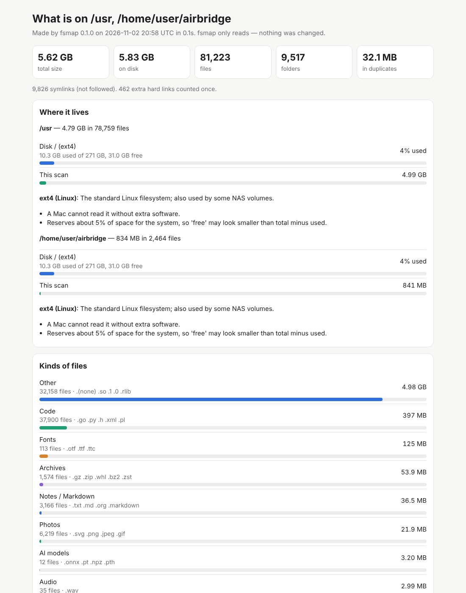

# fsmap — a read-only map of your disks

`fsmap` tells you two things:

1. **What kind of disk is this?** — `fsmap volumes` lists every mounted disk and network
   share, how full it is, and explains its filesystem type in plain words
   (for example: *exFAT has no journal, so always eject before unplugging*).
2. **What is filling it up?** — `fsmap scan` walks folders and reports the biggest folders,
   the largest files, what kinds of files there are (photos, videos, AI models…), how old
   they are, special folders (`.git`, `node_modules`, Synology `#recycle`, Time Machine…),
   clutter files (`._*`, `.DS_Store`) and, if you ask, duplicate files.

**fsmap only reads.** It never deletes, moves, renames or changes anything in the folders
it scans. The only files it writes are the report files you name with `--json` / `--html`.
(Put those reports somewhere else, like your home folder, not on the disk you are scanning.)

## Build it on a Mac

You need Rust (`curl https://sh.rustup.rs -sSf | sh`, or the airbridge installer already sets it up).

```bash
cd airbridge/fsmap
cargo build --release
./target/release/fsmap --help
# optional: put it on your PATH
cp target/release/fsmap /usr/local/bin/     # or ~/bin
```

Works on Apple Silicon and Intel Macs, and on Linux.

## Use it

```bash
fsmap volumes                 # disks and shares you can see in Finder
fsmap volumes --all           # also the hidden system volumes
fsmap volumes --json ~/volumes.json

fsmap scan ~/Documents                         # quick look
fsmap scan ~/Documents --depth 3 --top 40      # deeper, longer lists
fsmap scan ~/Pictures --dupes                  # also find duplicate files (≥ 1 MiB)
fsmap scan ~/Pictures --dupes --min-dupe-size 10MB
fsmap scan /Volumes/X --json ~/x.json --html ~/x.html   # save reports
```

| Option | Meaning |
|---|---|
| `--depth N` | rank folders down to N levels below each scanned folder (default 2) |
| `--top N` | how many items in each "biggest" list (default 25) |
| `--dupes` | look for duplicate files: same size → same first/last 64 KiB → same full hash |
| `--min-dupe-size S` | skip smaller files when looking for duplicates (default `1MiB`; also `500k`, `2G`, `10MB`) |
| `--cross-filesystems` | also walk into other disks mounted inside the folder (off by default, so scanning `/` does not wander into `/Volumes`) |
| `--json FILE` | everything, as JSON |
| `--html FILE` | one offline web page (light & dark, works on a phone) |
| `--threads N` | worker threads (default: automatic) |
| `--no-progress` | hide the live "scanning… N files" line |

### Reading the numbers

* **size** is what Finder calls "Size"; **on disk** is the space really used (blocks).
* Sizes use decimal units like Finder: 1 GB = 1,000,000,000 bytes.
* Hard links (one file with two names) are counted once. Symlinks are counted but never followed.
* **APFS clones:** two "duplicates" on APFS may share the same blocks, so deleting one can free
  nothing. APFS "used" can also be smaller than the sum of the files.
* Network shares (SMB/AFP) are slower to scan and their "on disk" sizes come from the NAS.

## Goal 27: map Daniel's disks (copy-paste on the Mac)

All commands below only **read**. Reports go to `~/fsmap-reports`, which is on the Mac's
internal disk, not on the disks being scanned.

```bash
mkdir -p ~/fsmap-reports && cd ~/fsmap-reports

# 0. See every disk and share, and what type each one is.
fsmap volumes --json volumes.json

# 1. SecondBrain (Obsidian vault on Volume1)
fsmap scan /Volumes/Volume1/SecondBrain --depth 3 --dupes \
  --json secondbrain.json --html secondbrain.html

# 2. NAS Volume1 and Volume2 (Synology SMB shares; mount them in Finder first: ⌘K, smb://<nas>)
fsmap scan /Volumes/Volume1 --depth 2 --dupes --min-dupe-size 10MB \
  --json nas-volume1.json --html nas-volume1.html
fsmap scan /Volumes/Volume2 --depth 2 --dupes --min-dupe-size 10MB \
  --json nas-volume2.json --html nas-volume2.html

# 3. The 4TB hard drive and the 256Gb USB stick.
#    Find their exact names with `fsmap volumes` (or `ls /Volumes`), then:
fsmap scan "/Volumes/<4TB HDD name>" --depth 2 --dupes --min-dupe-size 10MB \
  --json hdd-4tb.json --html hdd-4tb.html
fsmap scan "/Volumes/<256Gb USB name>" --depth 2 --dupes \
  --json usb-256gb.json --html usb-256gb.html

open *.html
```

Tips: network shares take longer — leave the Mac awake (`caffeinate -i fsmap scan …`).
If macOS asks whether Terminal may access a removable or network volume, say yes (read
access is all fsmap needs). If you see "could not be read" entries, give Terminal **Full Disk
Access** in System Settings → Privacy & Security.

## For developers

```bash
cargo test
cargo clippy --all-targets -- -D warnings
rustup target add aarch64-apple-darwin x86_64-apple-darwin
cargo check --target aarch64-apple-darwin && cargo check --target x86_64-apple-darwin
```

See [DESIGN.md](DESIGN.md) for why it is built this way.


