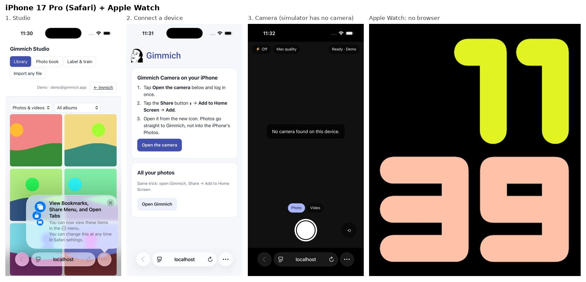
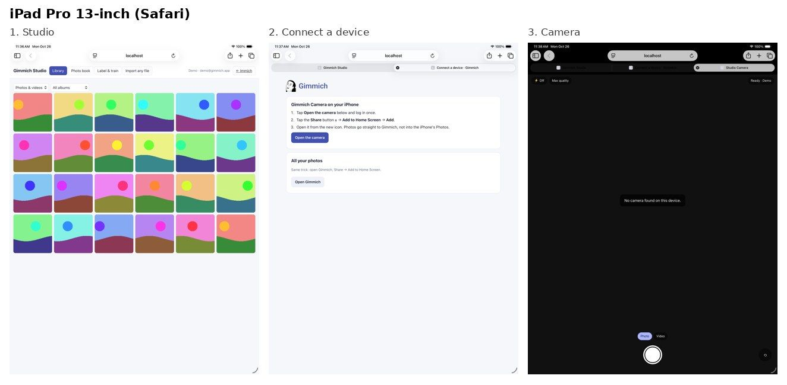
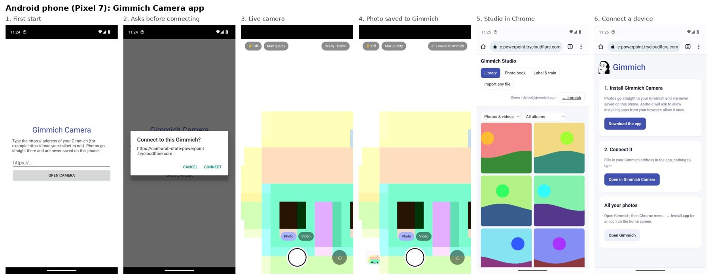
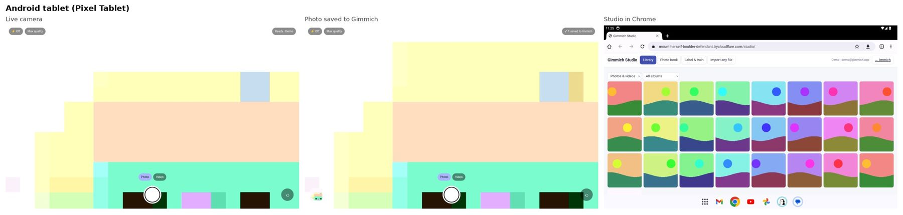

# Gimmich: everything in one place

Gimmich is your own photo system: **Immich** (the photo app) plus **Gimmich Studio** (extra AI tools),
running on your own computer (the iMac at home), reachable from your phone, tablet and laptop.

## What is in this folder

| Part | Where | What it is |
|---|---|---|
| Studio | [`studio/`](studio/) | one Rust program: labels, faces, editing, printing, photo book, mosaic, speech-to-text, file formats |
| Camera | [`studio/static/camera/`](studio/static/camera/) | camera page: photos go straight to Gimmich, never stay on the phone |
| Android app | [`android/`](android/) (ready file: `android/release/GimmichCamera-1.1.apk`) | the camera as an Android app |
| Desktop apps | [`desktop/`](desktop/) | Mac (.dmg), Windows (.exe), Linux (.deb) |
| Installer | [`installer/`](installer/) | one command sets up everything on the iMac |
| Gateway | [`gateway/`](gateway/) | one address for Immich + Studio |
| Device tests | [`device-tests/`](device-tests/) and the **Gimmich on devices** workflow | tries the app on iPhone, iPad, Apple Watch, Android phone and tablet |
| Training | [`eval/`](eval/) | how the AI models were trained and measured (offline only) |

The full guide (install, every tool, measured results, honest limits) is in [README.md](README.md).

## Tested and working

| What | Result |
|---|---|
| End-to-end test of the Studio (`studio/tests/test_api.py`) | **16 of 16** checks pass on the Rust-only Docker image |
| Rust unit tests (`cargo test`) | **8 of 8** pass |
| File formats (`gimmich-studio check-formats`) | **32 of 32** sample files open (RAW from 8 camera makes, HEIC, PSD, JPEG XL …) |
| Camera on 10 browser device profiles (`studio/tests/camera_devices.js`) | 10 of 10 |
| **Real simulators and emulators** (below) | iPhone ✅ iPad ✅ Apple Watch ✅ (no browser there) Android phone ✅ Android tablet ✅ |

## On every device (simulators, last run all green)

**iPhone 17 Pro (Safari) and Apple Watch.** The Apple simulators have no camera, so the Camera page
says so. The watch has no web browser, so nothing of Gimmich can open there.

**iPad Pro 13-inch**

**Android phone (Pixel 7): the Gimmich Camera app.** It installs, asks before connecting, shows the camera,
takes a photo, and the photo really arrives ("✓ 1 saved to Immich").

**Android tablet (Pixel Tablet)**

Found by these tests and fixed: the round shutter button sat on the left before the first photo, and a
device without a camera was told to "allow camera access" instead of "no camera found".

Run them again: **Actions → Gimmich on devices → Run workflow**, then download the `gimmich-…`
screenshot folders at the bottom of the run (about 15 minutes). The same test also lives in
[fablab503-collab/Simulator-](https://github.com/fablab503-collab/Simulator-).

## Still worth checking by hand

* Take one photo with the camera on a **real iPhone** (simulators have no camera).
* The device tests use a stand-in server with pretend photos; your real library is only on the iMac.
* No face system is right "100 %" of the time; see *Honest limits* in [README.md](README.md).
